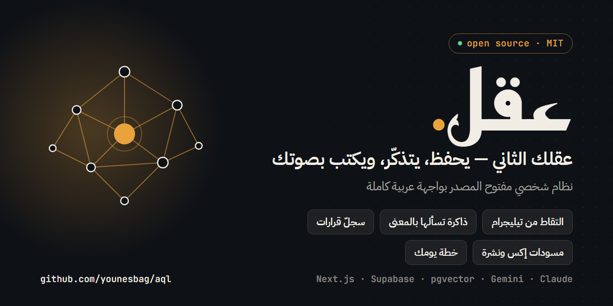

# عقل — Aql

[](https://vercel.com/new/clone?repository-url=https%3A%2F%2Fgithub.com%2Fyounesbag%2Faql&project-name=aql&repository-name=aql&env=OWNER_NAME%2CNEXT_PUBLIC_SUPABASE_URL%2CNEXT_PUBLIC_SUPABASE_ANON_KEY%2CSUPABASE_SERVICE_ROLE_KEY%2CGEMINI_API_KEY%2CCRON_SECRET&envDescription=Your%20name%20%28OWNER_NAME%29%2C%20Supabase%20URL%20%2B%20anon%20%28or%20publishable%29%20key%20%2B%20service_role%20%28or%20secret%29%20key%20%28Project%20Settings%20%3E%20API%29%2C%20a%20Gemini%20API%20key%2C%20and%20any%20long%20random%20string%20for%20CRON_SECRET.%20Telegram%2C%20Claude%2C%20Loops%20and%20Typefully%20can%20be%20added%20later.&envLink=https%3A%2F%2Fgithub.com%2Fyounesbag%2Faql%2Fblob%2Fmain%2Fdocs%2FSETUP.md%236-environment-variables)

[العربية](#العربية) · [English](#english)

---

## العربية

### ما هذا المشروع؟

قالب مفتوح المصدر لنظام ذكاء شخصي **لمستخدم واحد** (صاحب الحساب): ذاكرة دلالية دائمة قابلة للاستجواب، ومختبر محتوى (إكس + نشرة بريدية)، وسجلّ قرارات يستخرج الأنماط. واجهته عربية بالكامل بتصميم RTL.

**التعريف الصادق:** هو *ذاكرة دلالية + مختبر محتوى + سجلّ قرارات*. ليس «وعياً» ولا كياناً يفكّر ذاتياً. النماذج تسترجع من ذاكرتك وتولّد من سياق يُحقن في كل نداء؛ أوزانها لا تتعلّم منك. التسمية الدقيقة تحميك من توقعات خاطئة.

**الفكرة المحورية:** العائق الأهم ليس الكود بل بنية البيانات. كل قرار أو فكرة يُخزَّن بحقول (السياق + السبب + النتيجة) منذ اليوم الأول، وهذا ما يحوّل النظام من أرشيف إلى مادة تحليل مفيدة بعد أشهر من الاستخدام.

### الميزات

**ست شاشات في الواجهة:**

| الشاشة | المسار | ماذا تفعل |
|--------|--------|-----------|
| الالتقاط | `/capture` | إدخال فكرة أو ملاحظة أو رابط أو مقال؛ تُضمَّن وتُصنَّف فوراً |
| الذاكرة | `/memory` | بحث دلالي في كل ما التقطته (pgvector) |
| العقل | `/chat` | محادثة مع «العقل الموحّد»: وكيل بتسع أدوات يستعلم ذاكرتك بطبقة وصول مهيكلة |
| المحتوى | `/content` | مختبر منشورات إكس: تحليل الفكرة ← مسودة ← نقد، ومختبر أنماط الأداء |
| النشرة | `/newsletter` | مولّد نشرة بريدية: أفكار ← هيكل ← مسودة ← نقد، مع نشر اختياري عبر Loops |
| الرؤى | `/insights` | لوحة اليوم، سجلّ القرارات، المذكرة الأسبوعية، تقارير الأنماط |

**إعداد شخصي واحد:** ملف `data/profile.json` يحدّد ركائز محتواك وشرائح جمهورك ولهجتك (باسمها ومعجم قياس اختياري) ويوم مراجعتك الأسبوعية، بقيم افتراضية محايدة وتحقّق عربي عند التحميل.

**قناة تيليجرام (الالتقاط الأساسي):** أرسل نصاً أو صوتاً أو رابطاً أو ملف `.txt` فيُلتقط تلقائياً. أوامر البوت (العربية هي الأصل، ولكل أمر مرادف لاتيني لأن قائمة «/» في تيليجرام تقبل الأسماء اللاتينية فقط):

| الأمر | المرادف | الوظيفة |
|-------|---------|---------|
| `/اسأل سؤالك` (أو ابدأ الرسالة بـ«؟») | `/ask` | اسأل العقل الموحّد بذاكرتك كاملة |
| `/مسودات` | `/drafts` | مسودات إكس: نصّ للنسخ · وسم «نُشر» · حذف |
| `/خطة` | `/plan` | عرض خطة اليوم بحالاتها الحيّة |
| `/تم` | `/done` | علّم مهمة أُنجزت |
| `/مساء` | `/evening` | طقس المساء عند الطلب |
| `/مذكرة` | `/journal` | مسودة مذكرة الأسبوع وحفظها |
| `/أنماط` | `/patterns` | تقرير أنماط الإنجاز والمماطلة |
| `/مهمة نصّها` | `/task` | التقاط مهمة صريحة |
| `/رد بريد@مثال.كوم` | `/reply` | سجّل ردّ مشترك على نشرتك (يتطلب تفعيل Loops) |
| `/article نص المقال` | — | تحليل مقال (أو أرسل ملف `.txt`) |
| `/مساعدة` | `/help` | قائمة الأوامر |

**الطقوس اليومية (Vercel Cron):** طقس المساء يبني خطة الغد ويسألك عن نتائج قراراتك المعلّقة؛ احتياط الصباح يبني الخطة إن فات المساء ويرسل «رؤى الصباح».

**العامل الاختياري (VPS):** عامل صغير يلتقط طلبات جدول `generation_jobs` ويشغّل جلسات Claude Code المرتبطة باشتراكك (`claude -p`) بدل مفتاح API، وهو ما يتجاوز سقف 300 ثانية في خطة Vercel المجانية. أنواع المهام: مسودات إكس، الصور، مسودات Typefully، حصاد أرقام إكس، النشرة، تحديث «دفء» الجمهور، والنشر عبر Loops. الدليل: [`worker/README.md`](worker/README.md).

**تكاملات اختيارية:** Loops (نشر النشرة وتتبّع الأداء) · Typefully (جدولة إكس) · استيراد أرشيف إكس وقاعدة معرفة قديمة.

### المعمارية

| الطبقة | التقنية |
|--------|---------|
| الإطار | Next.js 16 (App Router) + TypeScript — الوسيط اسمه `proxy.ts` لا `middleware` |
| الواجهة | React 19 + Tailwind CSS v4، RTL |
| قاعدة البيانات | Supabase (PostgreSQL) + RLS بالمالك على كل جدول |
| البحث الدلالي | pgvector، تضمين Gemini بـ**768 بُعداً** |
| المصادقة | Supabase Auth (رابط سحري)، مستخدم واحد مسجَّل في جدول `app_owner` |
| الذكاء — تصنيف/تحليل/محادثة/خطة اليوم | Gemini عبر `lib/ai/gemini.ts` |
| الذكاء — الكتابة (إكس والنشرة) | Claude: عبر جلسة اشتراك على العامل (الافتراضي)، أو API مباشر طارئ عبر `lib/ai/anthropic.ts` |
| الاستضافة | Vercel (يعمل على خطة Hobby) |
| العامل | Node على VPS + systemd (اختياري) |

معرّفات النماذج الحيّة موجودة في `lib/ai/gemini.ts` و`lib/ai/anthropic.ts` — هما مصدر الحقيقة وتتغيّر مع الزمن.

### قرارات التصميم التي تستحق الإبقاء

- **768 بُعداً مجمّدة:** `VECTOR(768)` في قاعدة البيانات و`EMBED_DIM` في الكود. تغييرها يكسر كل المتجهات المخزَّنة.
- **بلا أطر وكلاء:** لا LangGraph ولا CrewAI. كل «وكيل» دالة بنداء نموذج واحد، والأدوات استعلامات مهيكلة في `lib/agents/access.ts` — لا SQL حرّ من النماذج.
- **SDKs مباشرة:** `@anthropic-ai/sdk` و`@google/genai` فقط، عبر بوابتين وحيدتين (`lib/ai/gemini.ts` و`lib/ai/anthropic.ts`). لا SDK نموذج خارجهما.
- **الأخطاء قيم لا استثناءات:** إجراءات الخادم تُعيد `{ ok: true, ... } | { ok: false, error }` لأن Next.js في الإنتاج يحذف رسائل الأخطاء المرميّة ويستبدلها بنصّ عامّ.
- **JSON مقيّد بمخطط:** كل مخرج نموذج يُفكَّك لاحقاً مقيَّد بمخطط (`responseJsonSchema` في Gemini، `output_config.format.json_schema` في Claude). وضع JSON وحده لا يضمن JSON صالحاً.
- **التصنيف الكسول:** الالتقاط الحيّ يُصنَّف فوراً، أما الاستيراد التاريخي فيدخل بتضمين فقط ويُصنَّف حين يُلمس فعلاً.
- **البناء بلا مفاتيح:** عملاء SDK كسولون، فينجح `npm run build` بلا أي متغيّر بيئة.
- **مستخدم واحد، RLS صارم:** لا مالك مسجَّل في `app_owner` يعني لا وصول لأحد.

### النشر بنقرة على Vercel

[](https://vercel.com/new/clone?repository-url=https%3A%2F%2Fgithub.com%2Fyounesbag%2Faql&project-name=aql&repository-name=aql&env=OWNER_NAME%2CNEXT_PUBLIC_SUPABASE_URL%2CNEXT_PUBLIC_SUPABASE_ANON_KEY%2CSUPABASE_SERVICE_ROLE_KEY%2CGEMINI_API_KEY%2CCRON_SECRET&envDescription=Your%20name%20%28OWNER_NAME%29%2C%20Supabase%20URL%20%2B%20anon%20%28or%20publishable%29%20key%20%2B%20service_role%20%28or%20secret%29%20key%20%28Project%20Settings%20%3E%20API%29%2C%20a%20Gemini%20API%20key%2C%20and%20any%20long%20random%20string%20for%20CRON_SECRET.%20Telegram%2C%20Claude%2C%20Loops%20and%20Typefully%20can%20be%20added%20later.&envLink=https%3A%2F%2Fgithub.com%2Fyounesbag%2Faql%2Fblob%2Fmain%2Fdocs%2FSETUP.md%236-environment-variables)

1. **قبل الزر:** أنشئ مشروع Supabase مجانياً ونفّذ في محرر SQL الملفين `supabase/migrations/0001_init.sql` ثم `0002_configurable_pillars.sql` ([الخطوات 2–3](docs/SETUP.md)).
2. **اضغط الزر:** ينسخ Vercel المستودع إلى حسابك ويطلب ستة متغيّرات: اسمك، ورابط Supabase ومفتاحيه: anon أو publishable، وservice_role أو secret (من Project Settings ← API)، ومفتاح Gemini، وأي نصّ عشوائي طويل لـ`CRON_SECRET`.
3. **بعد النشر:** أنشئ مستخدمك في Supabase Auth وسجّل UID في `app_owner` ([الخطوة 4](docs/SETUP.md))، وأضف عنوان النشر في Site URL وRedirect URLs. ثم ادخل من `/login`.

تيليجرام والعامل وClaude وLoops وTypefully اختيارية وتُضاف لاحقاً من إعدادات المشروع في Vercel.

### بداية سريعة (تشغيل محلي)

الدليل الكامل خطوة بخطوة في [`docs/SETUP.md`](docs/SETUP.md). الاختصار:

1. أنشئ مشروع Supabase وفعّل `vector` ونفّذ `supabase/migrations/0001_init.sql` ثم `0002_configurable_pillars.sql`.
2. أنشئ مستخدمك في Supabase Auth وسجّل UID في `app_owner`.
3. املأ قوالب `data/*.md` وراجع `data/profile.json` (ركائز المحتوى وشرائح الجمهور واللهجة ويوم المراجعة الأسبوعية — انظر [`data/README.md`](data/README.md)).
4. انسخ `.env.example` إلى `.env.local` واملأه، ثم `npm install && npm run dev`.
5. انشر على Vercel، واربط بوت تيليجرام، وأضف العامل والتكاملات إن أردت.

### المساهمة

اقرأ [`CLAUDE.md`](CLAUDE.md) — دستور هندسي يلخّص الأعراف والأخطاء المسمّاة وفحوص الجودة (يقرؤه المساهمون ووكلاء الذكاء الاصطناعي معاً). التفاصيل في [`CONTRIBUTING.md`](CONTRIBUTING.md).

### الترخيص

MIT — انظر [`LICENSE`](LICENSE).

### نسبة العمل

Originally built by Younes (@younesbag1).

---

## English

### What is this?

An open-source template for a **single-owner** personal intelligence system: a durable, queryable semantic memory; a content lab (X posts + email newsletter); and a decision log that surfaces patterns. The UI is fully Arabic with a complete RTL layout.

**Honest definition:** it is *semantic memory + content lab + decision log*. It is not a "conscious" AI and it does not think on its own. The models retrieve from your memory and generate from context injected into each call; their weights do not learn from you. Precise naming protects you from wrong expectations.

**Core idea:** the hard part is not the code, it is the data structure. Every decision or idea is stored with fields for context, reasoning and outcome from day one, which is what turns the system from an archive into something you can analyse after a few months of use.

### Features

**Six UI screens:**

| Screen | Route | Purpose |
|--------|-------|---------|
| Capture | `/capture` | Enter an idea, note, link or article; embedded and classified immediately |
| Memory | `/memory` | Semantic search over everything you captured (pgvector) |
| Mind | `/chat` | Chat with the unified mind: an agent with nine tools querying your memory through a structured access layer |
| Content | `/content` | X post lab: idea analysis, draft, critique, and a performance pattern lab |
| Newsletter | `/newsletter` | Newsletter generator: ideas, outline, draft, critique, optional publishing via Loops |
| Insights | `/insights` | Day board, decision log, weekly journal, pattern reports |

**One personal config file:** `data/profile.json` sets your content pillars, audience personas, dialect (name plus an optional measured marker list) and weekly review day, with neutral defaults and load-time validation (Arabic error messages).

**Telegram channel (primary capture):** send text, voice, a link or a `.txt` file and it is captured automatically. Bot commands (Arabic is canonical; each has a Latin alias because Telegram's "/" menu only accepts Latin command names):

| Command | Alias | What it does |
|---------|-------|--------------|
| `/اسأل <question>` (or start a message with "؟") | `/ask` | Ask the unified mind, using your whole memory |
| `/مسودات` | `/drafts` | X drafts: copyable text, mark published, delete |
| `/خطة` | `/plan` | Show today's plan with live statuses |
| `/تم` | `/done` | Mark a task as done |
| `/مساء` | `/evening` | Run the evening ritual on demand |
| `/مذكرة` | `/journal` | Draft and save the weekly journal |
| `/أنماط` | `/patterns` | Completion and procrastination pattern report |
| `/مهمة <text>` | `/task` | Capture an explicit task |
| `/رد email@example.com` | `/reply` | Log a subscriber's reply to your newsletter (needs Loops) |
| `/article <text>` | — | Analyse an article (or send a `.txt` file) |
| `/مساعدة` | `/help` | List commands |

**Daily rituals (Vercel Cron):** the evening ritual builds tomorrow's plan and asks about the outcomes of pending decisions; the morning fallback builds the plan if the evening one was missed and sends "morning insights".

**Optional worker (VPS):** a small worker that polls the `generation_jobs` queue and runs Claude Code sessions tied to your subscription (`claude -p`) instead of an API key. It sidesteps the 300-second function limit of Vercel's free plan. Job kinds: X drafts, visuals, Typefully drafts, X metrics harvest, newsletter, audience "warmth" refresh, and Loops publishing. See [`worker/README.md`](worker/README.md).

**Optional integrations:** Loops (newsletter publishing and performance tracking) · Typefully (X scheduling) · import of an X archive and of an older knowledge base.

### Architecture

| Layer | Technology |
|-------|-----------|
| Framework | Next.js 16 (App Router) + TypeScript — the request interceptor is `proxy.ts`, not `middleware` |
| UI | React 19 + Tailwind CSS v4, RTL |
| Database | Supabase (PostgreSQL) with owner-only RLS on every table |
| Semantic search | pgvector, Gemini embeddings at **768 dimensions** |
| Auth | Supabase Auth (magic link), one user registered in the `app_owner` table |
| AI — classify / analyse / chat / day plan | Gemini via `lib/ai/gemini.ts` |
| AI — writing (X and newsletter) | Claude: via a subscription session on the worker (default), or an emergency direct API path through `lib/ai/anthropic.ts` |
| Hosting | Vercel (works on the Hobby plan) |
| Worker | Node on a VPS + systemd (optional) |

Live model IDs live in `lib/ai/gemini.ts` and `lib/ai/anthropic.ts`; those files are the source of truth and change over time.

### Design decisions worth keeping

- **768 dimensions, frozen:** `VECTOR(768)` in the database and `EMBED_DIM` in code. Changing it breaks every stored vector.
- **No agent frameworks:** no LangGraph, no CrewAI. Each "agent" is a function making one model call, and the tools are structured queries in `lib/agents/access.ts` — no free-form SQL from models.
- **Direct SDKs:** only `@anthropic-ai/sdk` and `@google/genai`, behind two gateways (`lib/ai/gemini.ts`, `lib/ai/anthropic.ts`). No model SDK is used outside them.
- **Errors as values, not exceptions:** server actions return `{ ok: true, ... } | { ok: false, error }` because Next.js strips thrown error messages in production and replaces them with a generic one.
- **Schema-constrained JSON:** every model output that is later parsed is constrained by a schema (`responseJsonSchema` for Gemini, `output_config.format.json_schema` for Claude). JSON mode alone does not guarantee valid JSON.
- **Lazy classification:** live capture is classified immediately; historical imports are embedded only and classified when actually touched.
- **Build without keys:** SDK clients are lazy, so `npm run build` succeeds with no environment variables.
- **One user, strict RLS:** no owner in `app_owner` means no access for anyone.

### One-click deploy to Vercel

[](https://vercel.com/new/clone?repository-url=https%3A%2F%2Fgithub.com%2Fyounesbag%2Faql&project-name=aql&repository-name=aql&env=OWNER_NAME%2CNEXT_PUBLIC_SUPABASE_URL%2CNEXT_PUBLIC_SUPABASE_ANON_KEY%2CSUPABASE_SERVICE_ROLE_KEY%2CGEMINI_API_KEY%2CCRON_SECRET&envDescription=Your%20name%20%28OWNER_NAME%29%2C%20Supabase%20URL%20%2B%20anon%20%28or%20publishable%29%20key%20%2B%20service_role%20%28or%20secret%29%20key%20%28Project%20Settings%20%3E%20API%29%2C%20a%20Gemini%20API%20key%2C%20and%20any%20long%20random%20string%20for%20CRON_SECRET.%20Telegram%2C%20Claude%2C%20Loops%20and%20Typefully%20can%20be%20added%20later.&envLink=https%3A%2F%2Fgithub.com%2Fyounesbag%2Faql%2Fblob%2Fmain%2Fdocs%2FSETUP.md%236-environment-variables)

1. **Before the button:** create a free Supabase project and run `supabase/migrations/0001_init.sql` then `0002_configurable_pillars.sql` in its SQL editor ([steps 2–3](docs/SETUP.md#english)).
2. **Click the button:** Vercel clones the repo into your account and asks for six variables: your name, the Supabase URL plus its anon (or publishable) and service_role (or secret) keys (Project Settings → API), a Gemini key, and any long random string for `CRON_SECRET`.
3. **After deploy:** create your user in Supabase Auth, register its UID in `app_owner` ([step 4](docs/SETUP.md#english)), and add the deployment URL to Site URL / Redirect URLs. Then sign in at `/login`.

Telegram, the worker, Claude, Loops and Typefully are optional and can be added later in the Vercel project settings.

### Quick start (local)

Full step-by-step guide: [`docs/SETUP.md`](docs/SETUP.md). The short version:

1. Create a Supabase project, enable `vector`, run `supabase/migrations/0001_init.sql` then `0002_configurable_pillars.sql`.
2. Create your user in Supabase Auth and register its UID in `app_owner`.
3. Fill in the `data/*.md` templates and review `data/profile.json` (content pillars, audience personas, dialect, weekly review day — see [`data/README.md`](data/README.md)).
4. Copy `.env.example` to `.env.local`, fill it in, then `npm install && npm run dev`.
5. Deploy to Vercel, connect a Telegram bot, and add the worker and integrations if you want them.

### Contributing

Read [`CLAUDE.md`](CLAUDE.md) — an engineering constitution covering conventions, named mistakes and quality checklists (for human contributors and AI coding agents alike). See [`CONTRIBUTING.md`](CONTRIBUTING.md).

### License

MIT — see [`LICENSE`](LICENSE).

### Credit

Originally built by Younes (@younesbag1).
